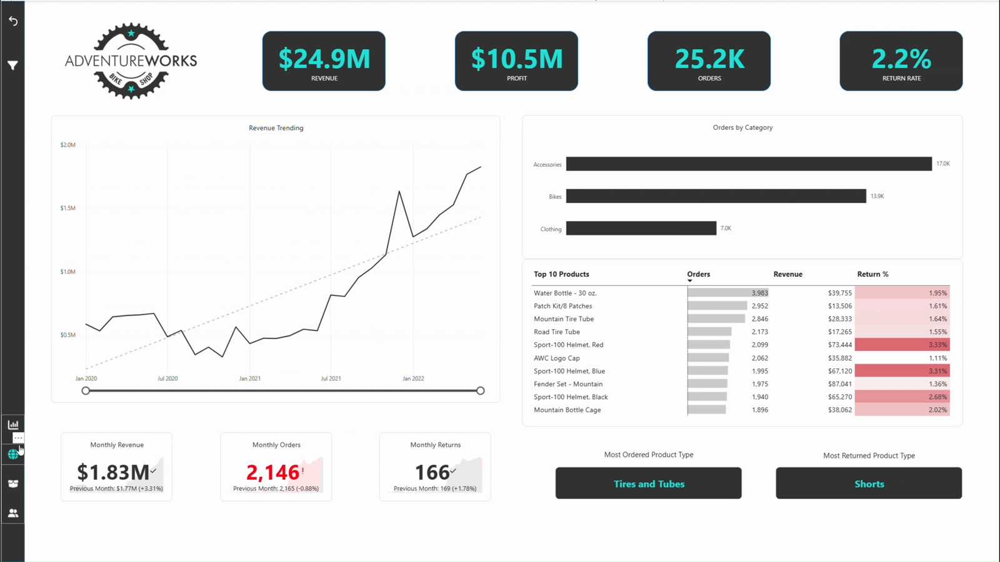

# AdventureWorks Sales Performance Dashboard

This is my AdventureWorks Power BI project, completed while learning business intelligence through [Microsoft Power BI Desktop for Business Intelligence](https://www.udemy.com/course/microsoft-power-bi-up-running-with-power-bi-desktop/). I applied what I learned about preparing data, building a model, creating DAX measures, and designing reports to the AdventureWorks sales data.

## Project Background

AdventureWorks is a fictional company that makes cycling equipment and accessories. Its management team needs to follow sales, revenue, profit, and returns; compare regional performance; understand product trends; and identify valuable customers.

The source files in this project include sales from 2020, 2021, and 2022, returns, and lookup data for dates, customers, products, product categories, subcategories, and territories. I used these files in the Power BI report to explore the business questions in the brief.

## How I Applied What I Learned

My learning progressed from understanding the Power BI workflow to preparing data, modeling tables, writing DAX, and designing dashboards. I applied those skills in the AdventureWorks project as follows.

### 1. Power BI Desktop Workflow

I learned how the preparation, model, and report stages fit together in Power BI Desktop. I applied that workflow by bringing the AdventureWorks data into one `.pbix` project, organizing the analysis around business questions, and building report pages to explore the results.

### 2. Connecting to and Shaping Data

I worked with the annual sales CSVs and the separate returns and lookup files. The report uses calendar fields such as year, month, quarter, and week for time analysis, along with product, category, customer, and territory fields for comparisons. This let me practise preparing multiple related sources for analysis instead of treating each CSV as a standalone answer.

### 3. Creating a Data Model

I learned how relationships, cardinality, and filter flow help tables work together. In the report, measures are analyzed alongside fields from tables such as `Calendar Lookup`, `Product Lookup`, `Product Categories Lookup`, `Product Subcategories Lookup`, `Customer Lookup`, and `Territory Lookup`. I also learned to model sales and returns as separate fact tables connected through shared lookup tables.

### 4. Calculating Measures with DAX

I practised using measures to answer the questions in the brief. The PBIX references measures including:

- `Total Revenue`, `Total Profit`, `Total Orders`, and `Total Returns`
- `Return Rate`
- Previous-month revenue, orders, and returns
- Revenue, profit, and order targets and target gaps
- `Total Customers` and `Average Revenue per Customer`

These calculations make it possible to review overall performance, change over time, compare actual results with targets, and examine customer value.

### 5. Visualizing Data with Dashboards

I applied the visual design topics by combining KPI cards, time-based charts, product tables, category comparisons, maps, slicers, and drillthrough pages. The PBIX has four report pages—`Exec Dashboard`, `Maps`, `Product Detail`, and `Customer Detail`—plus a hidden `Category Tooltip` page.

The pages use filters and interactions to let me move from an overall result to a product, customer, date, or territory view. `Product Detail` is configured as a drillthrough page, so a product can be examined in more detail from the wider report.

### 6. Performance Optimization

I also learned that performance matters when building a Power BI report. This project helped me think about the report as a working model as well as a set of visuals.

## What Is in My Report

### Exec Dashboard

The main page brings together revenue, profit, orders, and return rate. It also includes time-based KPIs, a top-products table with orders, revenue, and return percentage, and category comparisons. The preview image shows **$24.9M revenue**, **$10.5M profit**, **25.2K orders**, and a **2.2% return rate**; those figures can change when filters are applied.

### Maps

The Maps page provides a geographic view of sales territory data, with territory fields available for exploring regional results.

### Product Detail

This drillthrough page focuses on an individual product. It includes product-level sales and return analysis, with measures and visuals that support a closer look after selecting a product elsewhere in the report.

### Customer Detail

The customer page supports analysis by customer, income level, and occupation. It includes customer-level orders and revenue, customer counts, revenue per customer, and time-based analysis.

### Category Tooltip

The PBIX also contains a hidden tooltip page for category context when exploring report visuals.

## What I Learned

Building this project helped me connect what I learned into one workflow: prepare multiple source files, use descriptive tables to analyze facts from different perspectives, create measures for business questions, and present the results in an interactive report. I also learned how drillthrough, filters, and time fields help move from a summary KPI to a more specific explanation.

## Project Files

- `Adventure Works.pbix` — the Power BI report and model
- `dashboard-preview.png` — preview of the executive overview
- `AdventureWorks+Images/AdventureWorks Images/` — image assets used in the report
- `AdventureWorks+Raw+Data/AdventureWorks Raw Data/` — source CSV files used in the project

## Open the Project

1. Download `Adventure Works.pbix` from this repository.
2. Open it in Power BI Desktop.
3. Start with `Exec Dashboard`, then use the report navigation, filters, and drillthrough pages to explore the analysis.

## Data Note

AdventureWorks is fictional sample data provided for learning purposes. The results describe this sample dataset and do not represent a real company.

## Author

Pratik Prakash Gawde  
MSc Data Analytics, Berlin
